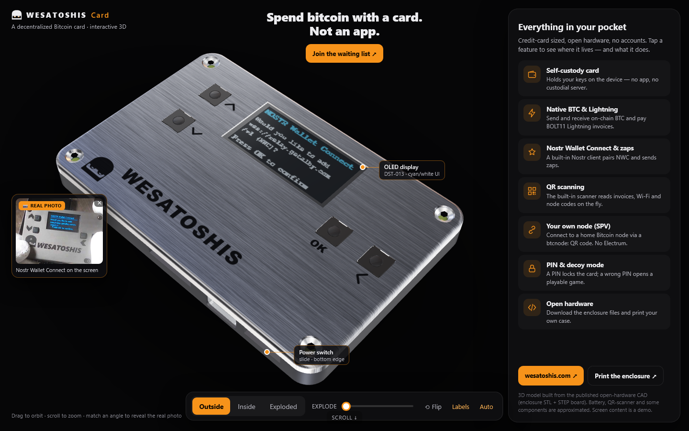

# 🟠 Wesatoshis Card in 3D

[Explore the interactive demo](https://itstomekk.github.io/wesatoshis-promo/) · [Wesatoshis](https://wesatoshis.com/) · [Enclosure files](https://wesatoshis.com/enclosure/)

Explore the Wesatoshis Bitcoin card from the outside, inside, and in an exploded view. Rotate the model, inspect components and see real product photographs alongside the interactive demo.

## 🧭 Getting started

Open the live demo or serve the `docs` folder locally as described in [DEVELOPMENT.md](DEVELOPMENT.md).

## 🔎 Notes

The 3D model is illustrative, not manufacturing CAD. Some components are approximations and on-screen content is a demonstration, not a live wallet. Product and security descriptions are based on manufacturer information and have not been independently verified. Published CAD, Wesatoshis branding and supplied product photos are used with permission; their inclusion does not imply an open-source license for those assets.

Built using [Three.js](https://threejs.org/). See [UPDATING.md](UPDATING.md) for deployment details.
